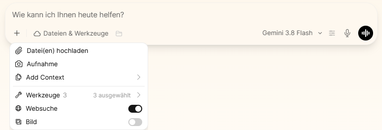
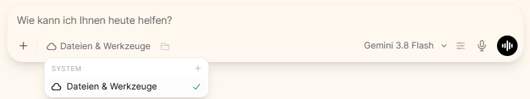
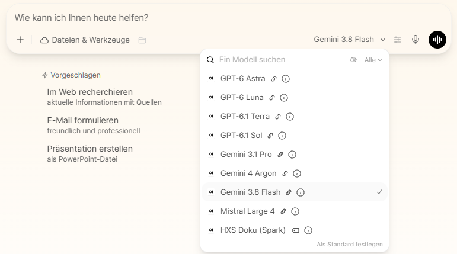
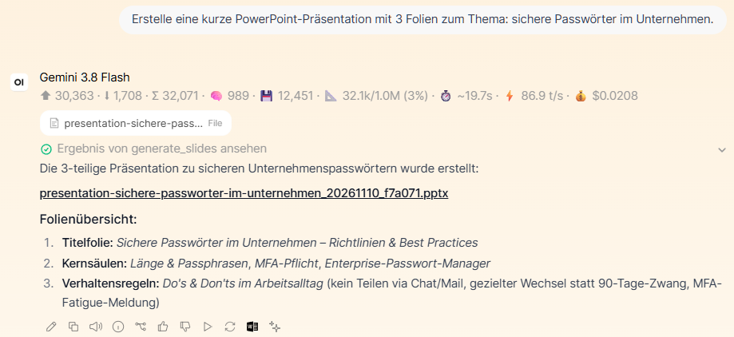
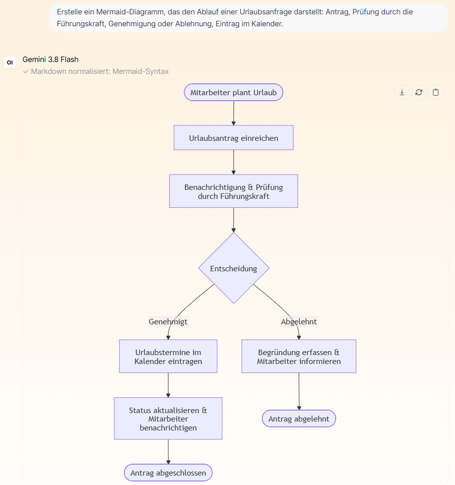
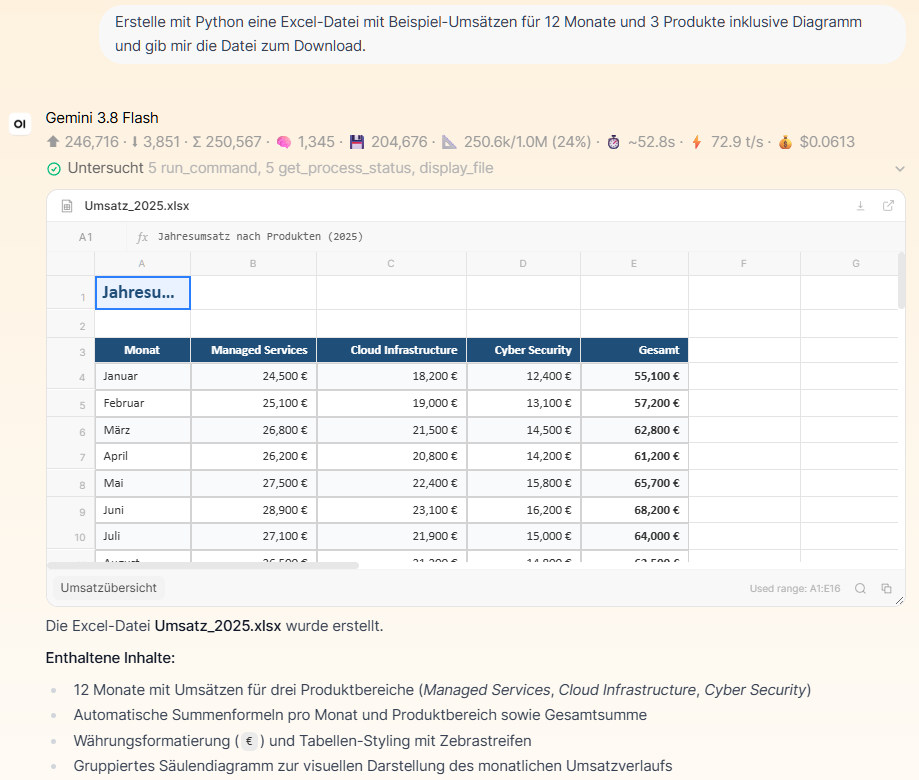

# KI-Plattform (Open WebUI): Anleitung für Anwenderinnen und Anwender

Diese Anleitung erklärt die wichtigsten Funktionen der KI-Plattform, die HXS für Ihr Unternehmen betreibt. Sie basiert auf [Open WebUI](https://openwebui.com) und funktioniert ähnlich wie ChatGPT, mit einigen zusätzlichen Möglichkeiten.

Welche Modelle und Funktionen bei Ihnen freigeschaltet sind, legt Ihr Unternehmen fest. Einzelne Punkte dieser Anleitung können daher bei Ihnen fehlen oder anders benannt sein.

## Inhalt

1. [Anmelden und loslegen](#1-anmelden-und-loslegen)
2. [Das richtige Modell wählen](#2-das-richtige-modell-wählen)
3. [Im Web suchen](#3-im-web-suchen)
4. [Mit Dateien arbeiten](#4-mit-dateien-arbeiten)
5. [Wissensdatenbanken](#5-wissensdatenbanken)
6. [Eigene Assistenten und Prompt-Vorlagen](#6-eigene-assistenten-und-prompt-vorlagen)
7. [Bilder erstellen und bearbeiten](#7-bilder-erstellen-und-bearbeiten)
8. [PowerPoint-Präsentationen](#8-powerpoint-präsentationen)
9. [Word-Dokumente und E-Mails](#9-word-dokumente-und-e-mails)
10. [Diagramme und Auswertungen](#10-diagramme-und-auswertungen)
11. [Programmieren und Dateien erzeugen: Dateien & Werkzeuge](#11-programmieren-und-dateien-erzeugen-dateien--werkzeuge)
12. [Sprache: diktieren und vorlesen](#12-sprache-diktieren-und-vorlesen)
13. [Weitere Funktionen](#13-weitere-funktionen)
14. [Gute Prompts schreiben](#14-gute-prompts-schreiben)
15. [Datenschutz und Vertraulichkeit](#15-datenschutz-und-vertraulichkeit)
16. [Häufige Fragen](#16-häufige-fragen)

---

## 1. Anmelden und loslegen

- Öffnen Sie die Adresse, die Sie von Ihrer IT erhalten haben.
- Melden Sie sich mit Ihrem **Microsoft-Firmenkonto** an (dasselbe wie für Outlook oder Teams). Ein eigenes Passwort für die Plattform gibt es nicht.
- Unten im Fenster schreiben Sie Ihre Frage oder Aufgabe und schicken sie mit **Enter** ab. **Umschalt + Enter** macht einen Zeilenumbruch.
- Links finden Sie Ihre bisherigen Chats. Jeder Chat bekommt automatisch einen Titel.
- Sprache der Oberfläche ändern: links unten auf Ihren Namen → **Einstellungen → Allgemein → Sprache**.

### Zusatzfunktionen am Eingabefeld

Über das **+** links im Eingabefeld erreichen Sie alles Weitere für den aktuellen Chat:

- **Datei(en) hochladen** und **Aufnahme** (Foto mit der Kamera)
- **Add Context**: Wissen, Notizen oder frühere Chats dazunehmen
- **Werkzeuge**: die Zusatzwerkzeuge des Modells (z. B. PowerPoint, E-Mail); sie sind schon ausgewählt
- **Websuche** und **Bild** (Bildgenerierung): Schalter für diesen Chat

### Dateien & Werkzeuge (wichtig für Dateien)

**Dateien & Werkzeuge** ist Ihr persönlicher Ordner auf dem Server, in dem die KI arbeitet: Sie kann dort Dateien erstellen und bearbeiten (Excel, Word, CSV …), Programme ausführen und Ihnen das Ergebnis zum Herunterladen geben. Andere Personen sehen Ihre Dateien nicht.

In der Regel ist **Dateien & Werkzeuge** bei den Modellen schon eingeschaltet. Am **Wolken-Symbol** am Eingabefeld sehen Sie, ob es aktiv ist. Steht dort nicht *Dateien & Werkzeuge*, klicken Sie auf das Wolken-Symbol und wählen es aus; dort schalten Sie es für einen Chat auch wieder aus.

### Unterschied zu ChatGPT

Sie können zwischen Modellen verschiedener Anbieter wählen (z. B. OpenAI, Google, Anthropic). Ihre Chats, Dateien und Einstellungen speichert die Plattform, die HXS für Ihr Unternehmen betreibt. Für die Antwort wird Ihre Anfrage aber an den Anbieter des gewählten Modells übermittelt (mehr dazu in Abschnitt 15).

## 2. Das richtige Modell wählen

Das Modell wählen Sie **rechts im Eingabefeld** (dort steht der Name des aktuellen Modells). Ein Modell ist voreingestellt, die wichtigsten sind zusätzlich links in der Seitenleiste angeheftet. Die genaue Auswahl ändert sich laufend, weil die Anbieter neue Modelle veröffentlichen. Als Faustregel:

| Art von Modell | Erkennbar an | Gut für |
|---|---|---|
| **Schnell und günstig** | Namen wie *Flash*, *Mini*, *Haiku*, *Nano* | Alltagsfragen, kurze Texte, Zusammenfassungen, Übersetzungen |
| **Stark / Allround** | Namen wie *Pro*, *Sonnet*, die Hauptmodelle eines Anbieters | Längere Texte, Analysen, anspruchsvolle Formulierungen, Code |
| **Besonders leistungsfähig** | Namen wie *Opus* oder die größten Modelle eines Anbieters | Schwierige Aufgaben, lange Dokumente, mehrstufiges Denken. Langsamer und teurer |

Die kurze Beschreibung beim Modell (Info-Symbol) hilft bei der Auswahl. Starten Sie mit dem voreingestellten Modell und wechseln Sie nur, wenn das Ergebnis nicht passt. Sie können das Modell auch mitten im Chat wechseln.

### Was eine Anfrage kostet

Die Anbieter rechnen nach **Tokens** ab. Ein Token ist ein Wortteil; eine Seite Text sind grob 500 bis 800 Tokens. Bezahlt wird für alles, was an das Modell geht (Ihre Frage, der bisherige Chatverlauf, angehängte Dateien, Suchergebnisse aus dem Web), und für alles, was zurückkommt (die Antwort, bei "denkenden" Modellen auch das Nachdenken). Antworten sind pro Token deutlich teurer als Eingaben.

Je nach Modell liegen die Preise sehr weit auseinander. Beispiele (Listenpreise der Anbieter in US-Dollar pro **1 Million Tokens**, Stand November 2026, ohne Gewähr):

| Modell | Eingabe | Antwort |
|---|---|---|
| Claude Haiku 5.5 | 0,10 $ | 0,50 $ |
| Gemini 3.8 Flash | 0,75 $ | 3,75 $ |
| GPT-6.1 Terra | 1,00 $ | 5,00 $ |
| Claude Sonnet 5.5 | 2,00 $ | 10,00 $ |
| GPT-6.1 Sol | 2,00 $ | 10,00 $ |
| Gemini 3.1 Pro | 2,00 $ | 12,00 $ |
| Claude Opus 5.5 | 4,00 $ | 20,00 $ |

Eine Antwort von Claude Opus kostet also rund das 40-Fache derselben Antwort von Claude Haiku. Aktuelle Preise: [Anthropic](https://www.anthropic.com/pricing), [OpenAI](https://openai.com/api/pricing/), [Google](https://ai.google.dev/gemini-api/docs/pricing).

So halten Sie die Kosten niedrig:

- Für Alltägliches die schnellen Modelle verwenden, die großen nur für schwierige Aufgaben.
- Für ein neues Thema einen **neuen Chat** beginnen. In einem langen Chat wird bei jeder Frage der ganze bisherige Verlauf erneut mitgeschickt.
- Nur die Dateien anhängen, die für die Frage nötig sind.
- Websuche ausschalten, wenn Sie keine aktuellen Informationen brauchen.

## 3. Im Web suchen

Die Websuche ist bei den meisten Modellen bereits eingeschaltet. Das Modell sucht selbst, wenn die Frage aktuelle Informationen braucht, und nennt die Quellen als Link.

- Ein- und ausschalten: Schalter **Websuche** am Eingabefeld (siehe Abschnitt 1).
- Tipp: Schreiben Sie ausdrücklich "Recherchiere im Web …", wenn Sie sichergehen wollen, dass aktuell gesucht wird.

> Beispiel: *Recherchiere im Web die wichtigsten Änderungen bei der Pendlerpauschale 2026 und nenne die Quellen.*

## 4. Mit Dateien arbeiten

Ziehen Sie eine Datei ins Chatfenster oder hängen Sie sie über das **Plus-Symbol** an. Geeignet sind z. B. PDF, Word, Excel, PowerPoint, Text und Bilder.

- Das Modell liest die Datei bei Bedarf selbst, auch lange Dokumente vollständig, und nennt in der Antwort den **Dateinamen als Quelle**.
- Mehrere Dateien gleichzeitig sind möglich (Ihr Unternehmen kann Größe und Anzahl begrenzen).
- Bilder und Screenshots kann das Modell "sehen": z. B. eine Fehlermeldung, ein Diagramm oder eine handschriftliche Notiz.
- Auch eingescannte PDFs (Papierseiten ohne Text darin) kann das Modell lesen: Die Plattform erkennt den Text automatisch.
- Soll die KI eine Datei ändern (z. B. eine Spalte in Ihrer Excel-Datei ergänzen), legt sie eine Kopie in **Dateien & Werkzeuge** an (Abschnitt 1), bearbeitet sie dort und gibt Ihnen die geänderte Fassung zum Herunterladen.

> Beispiel: *Fasse den angehängten Vertrag in 10 Punkten zusammen und markiere alle Fristen.*

### Dateien aus OneDrive und SharePoint

Wenn Ihr Unternehmen das freigeschaltet hat, holen Sie Dateien direkt aus OneDrive oder SharePoint in den Chat, ohne sie vorher herunterzuladen.

1. Im Chat auf das **Plus-Symbol** klicken und **Microsoft OneDrive (work/school)** wählen.
2. Es öffnet sich ein eigenes Fenster (Pop-up) mit Ihrem OneDrive und den SharePoint-Seiten. Beim ersten Mal melden Sie sich dort mit Ihrem Firmenkonto an, falls Sie gefragt werden.
3. Datei auswählen und bestätigen. Sie erscheint im Chat wie eine angehängte Datei.

Gut zu wissen:

- Sie sehen nur Dateien, die Sie auch in OneDrive bzw. SharePoint öffnen dürfen.
- Die Datei wird als **Kopie** in den Chat übernommen. Ändert jemand die Datei später in SharePoint, bekommt der Chat das nicht mit: für den neuen Stand die Datei erneut auswählen.
- Öffnet sich kein Fenster, blockiert der Browser das Pop-up. Im Edge erscheint dann rechts in der Adressleiste ein Symbol: darauf klicken, **Pop-ups und Umleitungen immer zulassen** wählen und die Auswahl noch einmal öffnen (siehe Häufige Fragen).

## 5. Wissensdatenbanken

Eine Wissensdatenbank ist eine Sammlung von Dokumenten, auf die das Modell immer wieder zugreifen kann, z. B. Handbücher, Richtlinien oder Produktunterlagen.

1. **Arbeitsbereich → Wissen → Neu**: Namen vergeben und Dateien hochladen.
2. Im Chat **#** eintippen und die Wissensdatenbank auswählen. Oder: die Wissensdatenbank fest einem eigenen Assistenten zuordnen (siehe nächster Abschnitt).
3. Teilen: Sie können eine Wissensdatenbank für Kolleginnen und Kollegen bzw. Gruppen freigeben.

## 6. Eigene Assistenten und Prompt-Vorlagen

**Eigene Assistenten** (Arbeitsbereich → Modelle → Neu): Sie legen ein Basismodell fest und ergänzen eine feste Anweisung ("Du bist unser Assistent für Angebotstexte, antworte immer im Firmenstil …"), optional eine Wissensdatenbank. Der Assistent erscheint dann in der Modellauswahl und kann geteilt werden.

**Prompt-Vorlagen** (Arbeitsbereich → Prompts): Häufig genutzte Anweisungen speichern Sie als Vorlage. Im Chat rufen Sie sie mit **/** und dem Namen auf.

> Beispiel für eine Vorlage `/protokoll`: *Erstelle aus den folgenden Notizen ein Besprechungsprotokoll mit Teilnehmern, Entscheidungen und offenen Punkten (Wer, Was, Bis wann):*

## 7. Bilder erstellen und bearbeiten

1. Über das **+** am Eingabefeld den Schalter **Bild** einschalten. Ohne den Schalter beschreiben manche Modelle das Bild nur oder zeichnen eine einfache Grafik als Code.
2. Das gewünschte Bild möglichst genau beschreiben: Motiv, Stil, Farben, Format.
- Bearbeiten: Bild anhängen und beschreiben, was geändert werden soll ("Hintergrund weiß", "Logo entfernen").

> Beispiel: *Erstelle ein freundliches, modernes Titelbild für einen Newsletter zum Thema Fahrradfrühling, flache Illustration, Farben Grün und Weiß, Querformat.*

Hinweis: Bei Personen, Marken und Logos gelten Einschränkungen der Anbieter. Prüfen Sie Bildrechte, bevor Sie Bilder extern verwenden.

## 8. PowerPoint-Präsentationen

Die Plattform erstellt echte PowerPoint-Dateien (.pptx) zum Herunterladen.

**Neue Präsentation:**

> *Erstelle eine PowerPoint-Präsentation mit 8 Folien zum Thema "Einführung KI im Kundenservice": Titel, Ausgangslage, 3 Anwendungsfälle, Nutzen in Zahlen, Fahrplan, nächste Schritte.*

**Im Firmendesign:** Die Plattform erstellt Präsentationen in einem eigenen, neutralen Design. Ihre Firmenvorlage (Folienmaster, Schriften, Farben) übernehmen Sie anschließend in PowerPoint:

1. Präsentation auf der Plattform erstellen lassen und herunterladen.
2. In PowerPoint eine neue Präsentation aus Ihrer Firmenvorlage öffnen und die Folien übernehmen: **Start → Neue Folie → Folien wiederverwenden**, dabei "Quellformatierung beibehalten" ausschalten.

Tipps: Inhalt und Gliederung zuerst im Chat abstimmen, dann die Präsentation erstellen lassen. Feinschliff (Bilder, exakte Positionen) machen Sie anschließend in PowerPoint.

## 9. Word-Dokumente und E-Mails

**Word:** Unter jeder Antwort gibt es eine Schaltfläche **"Export to Word"**. Sie erhalten die Antwort als formatierte .docx-Datei mit Überschriften, Listen und Tabellen.

- Eigene Word-Vorlagen (.dotx) werden dabei nicht verwendet. Für Briefe im Firmenlayout den Text exportieren und in Ihre Vorlage einfügen.

**E-Mails:** Bitten Sie um eine E-Mail, erscheint sie als Karte, die Sie bearbeiten, kopieren oder als .eml-Datei herunterladen und in Outlook öffnen können.

> Beispiel: *Schreibe eine freundliche E-Mail an einen Kunden, dass sich die Lieferung um eine Woche verzögert, mit Entschuldigung und neuem Termin 14.11.*

## 10. Diagramme und Auswertungen

**Ablaufdiagramme, Organigramme, Zeitpläne:** Bitten Sie um ein **Mermaid-Diagramm**. Es wird direkt im Chat gezeichnet.

> Beispiel: *Zeichne als Mermaid-Diagramm den Ablauf unserer Urlaubsbeantragung: Antrag, Prüfung durch Teamleitung, Genehmigung oder Rückfrage, Eintrag im Kalender.*

**Diagramme aus Zahlen (Balken, Linien, Torten):** Daten einfügen oder Excel-Datei anhängen und um eine Auswertung mit Diagramm bitten. Mit **Dateien & Werkzeuge** rechnet das Modell in Python und gibt Ihnen das Diagramm als Bild oder in einer Excel-Datei zum Herunterladen.

> Beispiel: *Werte die angehängte Excel-Tabelle aus: Umsatz pro Monat als Liniendiagramm und die drei stärksten Produkte als Balkendiagramm.*

## 11. Programmieren und Dateien erzeugen: Dateien & Werkzeuge

**Dateien & Werkzeuge** ist eine eigene Linux-Umgebung pro Person auf dem Server. Dort erzeugt und bearbeitet die KI Dateien (Excel, Word, CSV …), rechnet Auswertungen, zeichnet Diagramme und führt auch größere Skripte aus.

- Das Modell schreibt den Code, führt ihn aus und erklärt das Ergebnis.
- **Für Dateien zum Herunterladen muss Dateien & Werkzeuge eingeschaltet sein** (meist ist es das schon, siehe Abschnitt 1). Ist es ausgeschaltet, kann die KI keine Datei erzeugen.
- Die fertige Datei zeigt die KI direkt im Chat an, mit Vorschau und Download-Schaltfläche. Alle Ihre Dateien finden Sie außerdem im Seitenfenster **Dateien**.
- Ihre Dateien bleiben in Ihrem Ordner erhalten; andere Personen sehen sie nicht.
- Für Programmier- und Rechenaufgaben die starken Modelle wählen (siehe Abschnitt 2). Schnelle Modelle weichen eher aus und liefern nur Code zum Selbst-Ausführen.

> Beispiel (Dateien & Werkzeuge): *Erstelle mit Python eine Excel-Datei mit Beispiel-Umsätzen für 12 Monate und 3 Produkte inklusive Diagramm und gib mir die Datei zum Download.*

## 12. Sprache: diktieren und vorlesen

- **Diktieren:** Mikrofon-Symbol im Eingabefeld. Ihr gesprochener Text wird in Text umgewandelt.
- **Vorlesen:** Lautsprecher-Symbol unter einer Antwort.
- **Sprachgespräch:** Über das Anruf-Symbol sprechen Sie direkt mit dem Modell.

## 13. Weitere Funktionen

- **Erinnerungen (Memory):** Die KI kann sich Dinge über Sie merken (z. B. "Ich arbeite im Vertrieb, antworte kurz"). Verwalten unter **Einstellungen → Personalisierung**. Dort können Sie Einträge ansehen und löschen.
- **Temporärer Chat:** Wird nicht gespeichert. Einschalten in der Modellauswahl oben.
- **Ordner:** Chats in Ordner sortieren (links in der Seitenleiste).
- **Notizen:** Eigene Notizen anlegen und mit der KI überarbeiten.
- **Chat teilen:** Über das Menü eines Chats einen Link erzeugen, den angemeldete Kolleginnen und Kollegen öffnen können.
- **Mehrere Modelle vergleichen:** In der Modellauswahl ein zweites Modell hinzufügen. Dieselbe Frage wird dann von beiden beantwortet.
- **Antworten bewerten:** Daumen hoch/runter unter einer Antwort hilft, die Plattform zu verbessern.

## 14. Gute Prompts schreiben

1. **Ziel nennen:** Was soll am Ende herauskommen? ("eine E-Mail", "eine Tabelle", "5 Ideen")
2. **Kontext geben:** Für wen, wozu, welcher Hintergrund? Lieber zu viel als zu wenig.
3. **Form festlegen:** Länge, Tonfall, Struktur ("max. 150 Wörter", "Du-Form", "als Tabelle").
4. **Beispiele zeigen:** Ein Beispiel für den gewünschten Stil wirkt besser als jede Beschreibung.
5. **Nachbessern:** Die erste Antwort ist ein Entwurf. Sagen Sie konkret, was anders sein soll.

KI kann sich irren und Fakten erfinden. Prüfen Sie wichtige Aussagen, Zahlen und Zitate, besonders bevor Sie sie weitergeben.

## 15. Datenschutz und Vertraulichkeit

- Die Plattform wird von HXS für Ihr Unternehmen betrieben. Ihre Chats sind für andere Benutzerinnen und Benutzer nicht sichtbar, sofern Sie sie nicht selbst teilen.
- Ihre Eingaben werden zur Beantwortung an den Anbieter des gewählten Modells übermittelt (z. B. OpenAI, Google, Anthropic). Die Anbieter verwenden diese Daten laut ihren Geschäftsbedingungen für Firmenkunden nicht zum Training ihrer Modelle.
- **Nicht eingeben:** Passwörter, Zugangsdaten, Kreditkarten- und Bankdaten sowie besondere Kategorien personenbezogener Daten (z. B. Gesundheitsdaten), sofern Ihr Unternehmen das nicht ausdrücklich erlaubt.
- Personenbezogene Daten von Kundinnen und Kunden oder Kolleginnen und Kollegen nur, soweit es für die Aufgabe nötig ist. Oft reicht es, Namen zu ersetzen ("Kunde A").
- Es gelten die internen Richtlinien Ihres Unternehmens zur KI-Nutzung. Im Zweifel fragen Sie Ihre IT oder Ihre Datenschutzbeauftragte bzw. Ihren Datenschutzbeauftragten.
- Ergebnisse der KI sind Vorschläge: Die Verantwortung für den weiteren Gebrauch liegt bei Ihnen.

## 16. Häufige Fragen

**Ich sehe ein Modell oder eine Funktion aus dieser Anleitung nicht.**
Ihr Unternehmen schaltet Modelle und Funktionen frei. Wenden Sie sich an Ihre IT.

**Die Antwort ist abgeschnitten oder bricht ab.**
"Weiter" schreiben, oder die Antwort mit dem Pfeil-Symbol neu erzeugen lassen. Bei sehr langen Chats hilft ein neuer Chat.

**Die KI sagt, sie habe eine Datei erstellt, aber ich kann sie nicht herunterladen.**
Prüfen Sie am Wolken-Symbol, ob **Dateien & Werkzeuge** eingeschaltet ist, und lassen Sie die Datei neu erstellen. Wenn die Datei nur als Text oder Link ohne Download erscheint: "Zeig mir die Datei an" schreiben.
**Das Modell kennt aktuelle Ereignisse nicht.**
Websuche einschalten bzw. "Recherchiere im Web …" schreiben.

**Beim Klick auf OneDrive passiert nichts.**
Der Browser hat das Pop-up-Fenster blockiert. Im Edge (und in Chrome) zeigt ein Symbol rechts in der Adressleiste das an: darauf klicken, Pop-ups für die Adresse der Plattform immer zulassen und die Auswahl erneut öffnen.

**Ich komme nicht mehr hinein.**
Die Anmeldung läuft über Ihr Microsoft-Firmenkonto. Wenden Sie sich an Ihre IT, wenn die Anmeldung dort nicht klappt oder Sie keinen Zugriff auf die Plattform haben.
