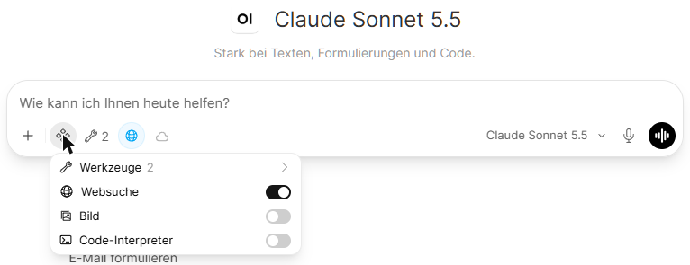
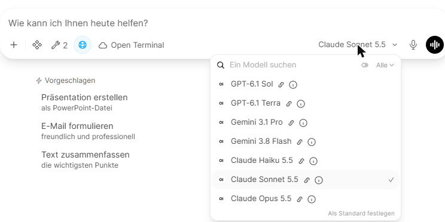
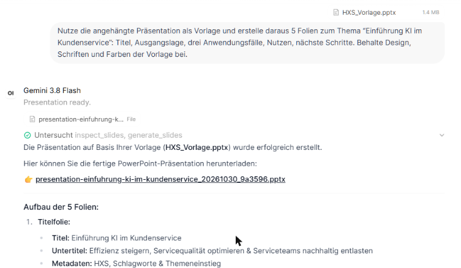
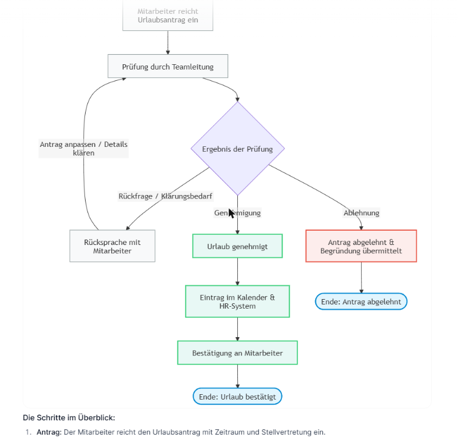
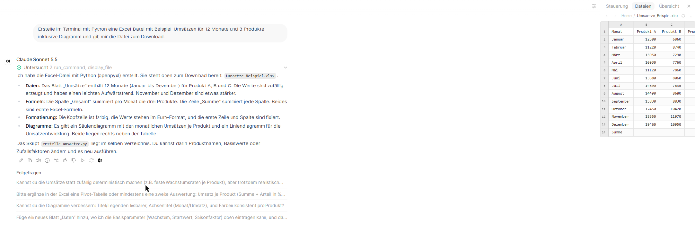

# KI-Plattform (Open WebUI): Anleitung für Anwenderinnen und Anwender

Diese Anleitung erklärt die wichtigsten Funktionen der KI-Plattform, die HXS für Ihr Unternehmen betreibt. Sie basiert auf [Open WebUI](https://openwebui.com) und funktioniert ähnlich wie ChatGPT, mit einigen zusätzlichen Möglichkeiten.

Welche Modelle und Funktionen bei Ihnen freigeschaltet sind, legt Ihr Unternehmen fest. Einzelne Punkte dieser Anleitung können daher bei Ihnen fehlen oder anders benannt sein.

## Inhalt

1. [Anmelden und loslegen](#1-anmelden-und-loslegen)
2. [Das richtige Modell wählen](#2-das-richtige-modell-wählen)
3. [Im Web suchen](#3-im-web-suchen)
4. [Mit Dateien arbeiten](#4-mit-dateien-arbeiten)
5. [Wissensdatenbanken](#5-wissensdatenbanken)
6. [Eigene Assistenten und Prompt-Vorlagen](#6-eigene-assistenten-und-prompt-vorlagen)
7. [Bilder erstellen und bearbeiten](#7-bilder-erstellen-und-bearbeiten)
8. [PowerPoint-Präsentationen](#8-powerpoint-präsentationen)
9. [Word-Dokumente und E-Mails](#9-word-dokumente-und-e-mails)
10. [Diagramme und Auswertungen](#10-diagramme-und-auswertungen)
11. [Programmieren: Code-Interpreter und Terminal](#11-programmieren-code-interpreter-und-terminal)
12. [Sprache: diktieren und vorlesen](#12-sprache-diktieren-und-vorlesen)
13. [Weitere Funktionen](#13-weitere-funktionen)
14. [Gute Prompts schreiben](#14-gute-prompts-schreiben)
15. [Datenschutz und Vertraulichkeit](#15-datenschutz-und-vertraulichkeit)
16. [Häufige Fragen](#16-häufige-fragen)

---

## 1. Anmelden und loslegen

- Öffnen Sie die Adresse, die Sie von Ihrer IT erhalten haben.
- Melden Sie sich mit Ihrem **Microsoft-Firmenkonto** an (dasselbe wie für Outlook oder Teams). Ein eigenes Passwort für die Plattform gibt es nicht.
- Unten im Fenster schreiben Sie Ihre Frage oder Aufgabe und schicken sie mit **Enter** ab. **Umschalt + Enter** macht einen Zeilenumbruch.
- Links finden Sie Ihre bisherigen Chats. Jeder Chat bekommt automatisch einen Titel.
- Sprache der Oberfläche ändern: links unten auf Ihren Namen → **Einstellungen → Allgemein → Sprache**.

**Die Schalter am Eingabefeld:** Über das Symbol mit den vier Punkten neben dem **+** schalten Sie Zusatzfunktionen für den aktuellen Chat ein und aus: **Websuche**, **Bild** (Bildgenerierung) und **Code-Interpreter**. Das Wolken-Symbol daneben öffnet das **Terminal**.

**Unterschied zu ChatGPT:** Sie können zwischen Modellen verschiedener Anbieter wählen (z. B. OpenAI, Google, Anthropic), und Ihre Daten liegen auf einer Plattform, die HXS für Ihr Unternehmen betreibt.

## 2. Das richtige Modell wählen

Das Modell wählen Sie **rechts im Eingabefeld** (dort steht der Name des aktuellen Modells). Ein Modell ist voreingestellt, die wichtigsten sind zusätzlich links in der Seitenleiste angeheftet. Die genaue Auswahl ändert sich laufend, weil die Anbieter neue Modelle veröffentlichen. Als Faustregel:

| Art von Modell | Erkennbar an | Gut für |
|---|---|---|
| **Schnell und günstig** | Namen wie *Flash*, *Mini*, *Haiku*, *Nano* | Alltagsfragen, kurze Texte, Zusammenfassungen, Übersetzungen |
| **Stark / Allround** | Namen wie *Pro*, *Sonnet*, die Hauptmodelle eines Anbieters | Längere Texte, Analysen, anspruchsvolle Formulierungen, Code |
| **Besonders leistungsfähig** | Namen wie *Opus* oder die größten Modelle eines Anbieters | Schwierige Aufgaben, lange Dokumente, mehrstufiges Denken. Langsamer und teurer |

Die kurze Beschreibung beim Modell (Info-Symbol) hilft bei der Auswahl. Starten Sie mit dem voreingestellten Modell und wechseln Sie nur, wenn das Ergebnis nicht passt. Sie können das Modell auch mitten im Chat wechseln.

## 3. Im Web suchen

Die Websuche ist bei den meisten Modellen bereits eingeschaltet. Das Modell sucht selbst, wenn die Frage aktuelle Informationen braucht, und nennt die Quellen als Link.

- Ein- und ausschalten: Schalter **Websuche** am Eingabefeld (siehe Abschnitt 1).
- Tipp: Schreiben Sie ausdrücklich "Recherchiere im Web …", wenn Sie sichergehen wollen, dass aktuell gesucht wird.

> Beispiel: *Recherchiere im Web die wichtigsten Änderungen bei der Pendlerpauschale 2026 und nenne die Quellen.*

## 4. Mit Dateien arbeiten

Ziehen Sie eine Datei ins Chatfenster oder hängen Sie sie über das **Plus-Symbol** an. Geeignet sind z. B. PDF, Word, Excel, PowerPoint, Text und Bilder.

- Das Modell liest die Datei bei Bedarf selbst und nennt in der Antwort den **Dateinamen als Quelle**.
- Mehrere Dateien gleichzeitig sind möglich (Ihr Unternehmen kann Größe und Anzahl begrenzen).
- Bilder und Screenshots kann das Modell "sehen": z. B. eine Fehlermeldung, ein Diagramm oder eine handschriftliche Notiz.

> Beispiel: *Fasse den angehängten Vertrag in 10 Punkten zusammen und markiere alle Fristen.*

## 5. Wissensdatenbanken

Eine Wissensdatenbank ist eine Sammlung von Dokumenten, auf die das Modell immer wieder zugreifen kann, z. B. Handbücher, Richtlinien oder Produktunterlagen.

1. **Arbeitsbereich → Wissen → Neu**: Namen vergeben und Dateien hochladen.
2. Im Chat **#** eintippen und die Wissensdatenbank auswählen. Oder: die Wissensdatenbank fest einem eigenen Assistenten zuordnen (siehe nächster Abschnitt).
3. Teilen: Sie können eine Wissensdatenbank für Kolleginnen und Kollegen bzw. Gruppen freigeben.

## 6. Eigene Assistenten und Prompt-Vorlagen

**Eigene Assistenten** (Arbeitsbereich → Modelle → Neu): Sie legen ein Basismodell fest und ergänzen eine feste Anweisung ("Du bist unser Assistent für Angebotstexte, antworte immer im Firmenstil …"), optional eine Wissensdatenbank. Der Assistent erscheint dann in der Modellauswahl und kann geteilt werden.

**Prompt-Vorlagen** (Arbeitsbereich → Prompts): Häufig genutzte Anweisungen speichern Sie als Vorlage. Im Chat rufen Sie sie mit **/** und dem Namen auf.

> Beispiel für eine Vorlage `/protokoll`: *Erstelle aus den folgenden Notizen ein Besprechungsprotokoll mit Teilnehmern, Entscheidungen und offenen Punkten (Wer, Was, Bis wann):*

## 7. Bilder erstellen und bearbeiten

1. Am Eingabefeld den Schalter **Bild** einschalten. Ohne den Schalter beschreiben manche Modelle das Bild nur oder zeichnen eine einfache Grafik als Code.
2. Das gewünschte Bild möglichst genau beschreiben: Motiv, Stil, Farben, Format.
- Bearbeiten: Bild anhängen und beschreiben, was geändert werden soll ("Hintergrund weiß", "Logo entfernen").

> Beispiel: *Erstelle ein freundliches, modernes Titelbild für einen Newsletter zum Thema Fahrradfrühling, flache Illustration, Farben Grün und Weiß, Querformat.*

Hinweis: Bei Personen, Marken und Logos gelten Einschränkungen der Anbieter. Prüfen Sie Bildrechte, bevor Sie Bilder extern verwenden.

## 8. PowerPoint-Präsentationen

Die Plattform erstellt echte PowerPoint-Dateien (.pptx) zum Herunterladen.

**Neue Präsentation:**

> *Erstelle eine PowerPoint-Präsentation mit 8 Folien zum Thema "Einführung KI im Kundenservice": Titel, Ausgangslage, 3 Anwendungsfälle, Nutzen in Zahlen, Fahrplan, nächste Schritte.*

**Im Firmendesign:** Die Plattform erstellt Präsentationen in einem eigenen, neutralen Design. Ihre Firmenvorlage (Folienmaster, Schriften, Farben) übernehmen Sie anschließend in PowerPoint:

1. Präsentation auf der Plattform erstellen lassen und herunterladen.
2. In PowerPoint eine neue Präsentation aus Ihrer Firmenvorlage öffnen und die Folien übernehmen: **Start → Neue Folie → Folien wiederverwenden**, dabei "Quellformatierung beibehalten" ausschalten.

Tipps: Inhalt und Gliederung zuerst im Chat abstimmen, dann die Präsentation erstellen lassen. Feinschliff (Bilder, exakte Positionen) machen Sie anschließend in PowerPoint.

## 9. Word-Dokumente und E-Mails

**Word:** Unter jeder Antwort gibt es eine Schaltfläche **"Export to Word"**. Sie erhalten die Antwort als formatierte .docx-Datei mit Überschriften, Listen und Tabellen.

- Eigene Word-Vorlagen (.dotx) werden dabei nicht verwendet. Für Briefe im Firmenlayout den Text exportieren und in Ihre Vorlage einfügen.

**E-Mails:** Bitten Sie um eine E-Mail, erscheint sie als Karte, die Sie bearbeiten, kopieren oder als .eml-Datei herunterladen und in Outlook öffnen können.

> Beispiel: *Schreibe eine freundliche E-Mail an einen Kunden, dass sich die Lieferung um eine Woche verzögert, mit Entschuldigung und neuem Termin 14.11.*

## 10. Diagramme und Auswertungen

**Ablaufdiagramme, Organigramme, Zeitpläne:** Bitten Sie um ein **Mermaid-Diagramm**. Es wird direkt im Chat gezeichnet.

> Beispiel: *Zeichne als Mermaid-Diagramm den Ablauf unserer Urlaubsbeantragung: Antrag, Prüfung durch Teamleitung, Genehmigung oder Rückfrage, Eintrag im Kalender.*

**Diagramme aus Zahlen (Balken, Linien, Torten):** Schalter **Code-Interpreter** einschalten, Daten einfügen oder Excel-Datei anhängen und um eine Auswertung mit Diagramm bitten. Das Modell rechnet in Python und zeigt das Diagramm als Bild im Chat.

> Beispiel: *Werte die angehängte Excel-Tabelle aus: Umsatz pro Monat als Liniendiagramm und die drei stärksten Produkte als Balkendiagramm.*

## 11. Programmieren: Code-Interpreter und Terminal

| | Code-Interpreter | Terminal (Open Terminal) |
|---|---|---|
| Was | Python direkt in Ihrem Browser | Eigene Linux-Umgebung pro Person auf dem Server |
| Gut für | Berechnungen, Auswertungen, Diagramme im Chat | Dateien erzeugen (Excel, Word, CSV …), größere Skripte, mehrere Dateien |
| Dateien herunterladen | Nein, Ergebnisse erscheinen nur im Chat | Ja, über das Seitenfenster **Dateien** |
| Einschalten | Schalter **Code-Interpreter** am Eingabefeld | Wolken-Symbol am Eingabefeld → **Open Terminal** |

- Das Modell schreibt den Code, führt ihn aus und erklärt das Ergebnis.
- **Für Dateien zum Herunterladen das Terminal verwenden.** Rechts öffnet sich das Seitenfenster mit Ihren Dateien, inklusive Vorschau. Von dort laden Sie die Datei herunter.
- Im Terminal bleiben Ihre Dateien erhalten; andere Personen sehen sie nicht.
- Für Programmier- und Rechenaufgaben die starken Modelle wählen (siehe Abschnitt 2). Schnelle Modelle weichen eher aus und liefern nur Code zum Selbst-Ausführen.

> Beispiel (Terminal): *Erstelle im Terminal mit Python eine Excel-Datei mit Beispiel-Umsätzen für 12 Monate und 3 Produkte inklusive Diagramm und gib mir die Datei zum Download.*

## 12. Sprache: diktieren und vorlesen

- **Diktieren:** Mikrofon-Symbol im Eingabefeld. Ihr gesprochener Text wird in Text umgewandelt.
- **Vorlesen:** Lautsprecher-Symbol unter einer Antwort.
- **Sprachgespräch:** Über das Anruf-Symbol sprechen Sie direkt mit dem Modell.

## 13. Weitere Funktionen

- **Erinnerungen (Memory):** Die KI kann sich Dinge über Sie merken (z. B. "Ich arbeite im Vertrieb, antworte kurz"). Verwalten unter **Einstellungen → Personalisierung**. Dort können Sie Einträge ansehen und löschen.
- **Temporärer Chat:** Wird nicht gespeichert. Einschalten in der Modellauswahl oben.
- **Ordner:** Chats in Ordner sortieren (links in der Seitenleiste).
- **Notizen:** Eigene Notizen anlegen und mit der KI überarbeiten.
- **Chat teilen:** Über das Menü eines Chats einen Link erzeugen, den angemeldete Kolleginnen und Kollegen öffnen können.
- **Mehrere Modelle vergleichen:** In der Modellauswahl ein zweites Modell hinzufügen. Dieselbe Frage wird dann von beiden beantwortet.
- **Antworten bewerten:** Daumen hoch/runter unter einer Antwort hilft, die Plattform zu verbessern.

## 14. Gute Prompts schreiben

1. **Ziel nennen:** Was soll am Ende herauskommen? ("eine E-Mail", "eine Tabelle", "5 Ideen")
2. **Kontext geben:** Für wen, wozu, welcher Hintergrund? Lieber zu viel als zu wenig.
3. **Form festlegen:** Länge, Tonfall, Struktur ("max. 150 Wörter", "Du-Form", "als Tabelle").
4. **Beispiele zeigen:** Ein Beispiel für den gewünschten Stil wirkt besser als jede Beschreibung.
5. **Nachbessern:** Die erste Antwort ist ein Entwurf. Sagen Sie konkret, was anders sein soll.

KI kann sich irren und Fakten erfinden. Prüfen Sie wichtige Aussagen, Zahlen und Zitate, besonders bevor Sie sie weitergeben.

## 15. Datenschutz und Vertraulichkeit

- Die Plattform wird von HXS für Ihr Unternehmen betrieben. Ihre Chats sind für andere Benutzerinnen und Benutzer nicht sichtbar, sofern Sie sie nicht selbst teilen.
- Ihre Eingaben werden zur Beantwortung an den Anbieter des gewählten Modells übermittelt (z. B. OpenAI, Google, Anthropic). Die Anbieter verwenden diese Daten laut ihren Geschäftsbedingungen für Firmenkunden nicht zum Training ihrer Modelle.
- **Nicht eingeben:** Passwörter, Zugangsdaten, Kreditkarten- und Bankdaten sowie besondere Kategorien personenbezogener Daten (z. B. Gesundheitsdaten), sofern Ihr Unternehmen das nicht ausdrücklich erlaubt.
- Personenbezogene Daten von Kundinnen und Kunden oder Kolleginnen und Kollegen nur, soweit es für die Aufgabe nötig ist. Oft reicht es, Namen zu ersetzen ("Kunde A").
- Es gelten die internen Richtlinien Ihres Unternehmens zur KI-Nutzung. Im Zweifel fragen Sie Ihre IT oder Ihre Datenschutzbeauftragte bzw. Ihren Datenschutzbeauftragten.
- Ergebnisse der KI sind Vorschläge: Die Verantwortung für den weiteren Gebrauch liegt bei Ihnen.

## 16. Häufige Fragen

**Ich sehe ein Modell oder eine Funktion aus dieser Anleitung nicht.**
Ihr Unternehmen schaltet Modelle und Funktionen frei. Wenden Sie sich an Ihre IT.

**Die Antwort ist abgeschnitten oder bricht ab.**
"Weiter" schreiben, oder die Antwort mit dem Pfeil-Symbol neu erzeugen lassen. Bei sehr langen Chats hilft ein neuer Chat.

**Das Modell kennt aktuelle Ereignisse nicht.**
Websuche einschalten bzw. "Recherchiere im Web …" schreiben.

**Ich komme nicht mehr hinein.**
Die Anmeldung läuft über Ihr Microsoft-Firmenkonto. Wenden Sie sich an Ihre IT, wenn die Anmeldung dort nicht klappt oder Sie keinen Zugriff auf die Plattform haben.
