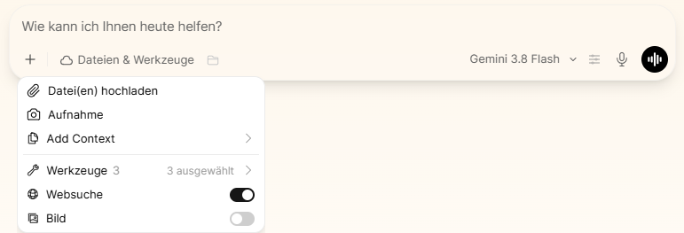
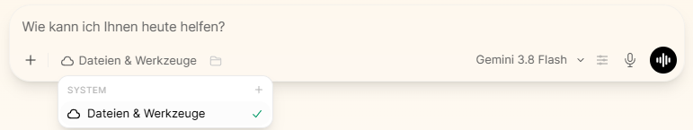
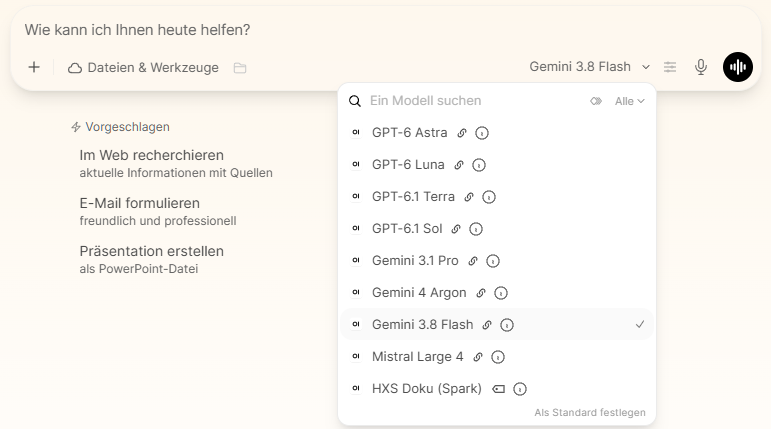
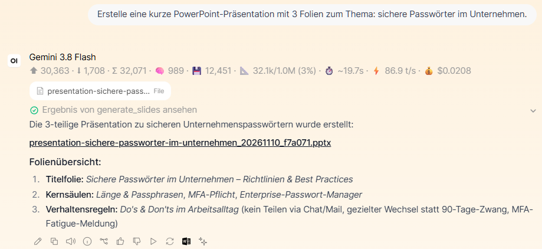
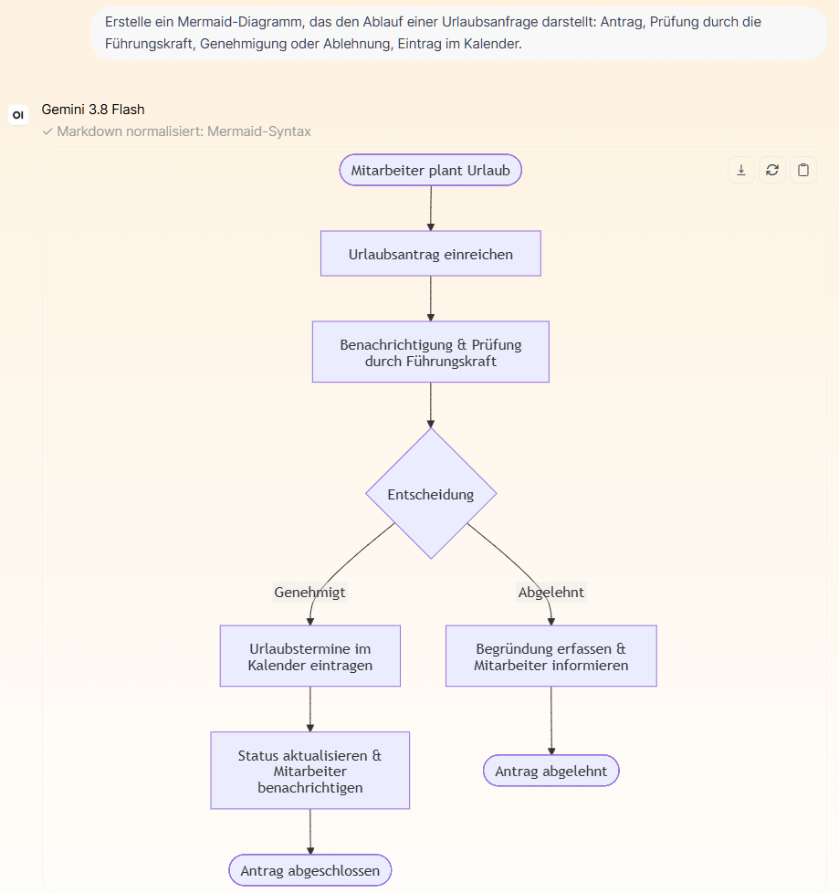
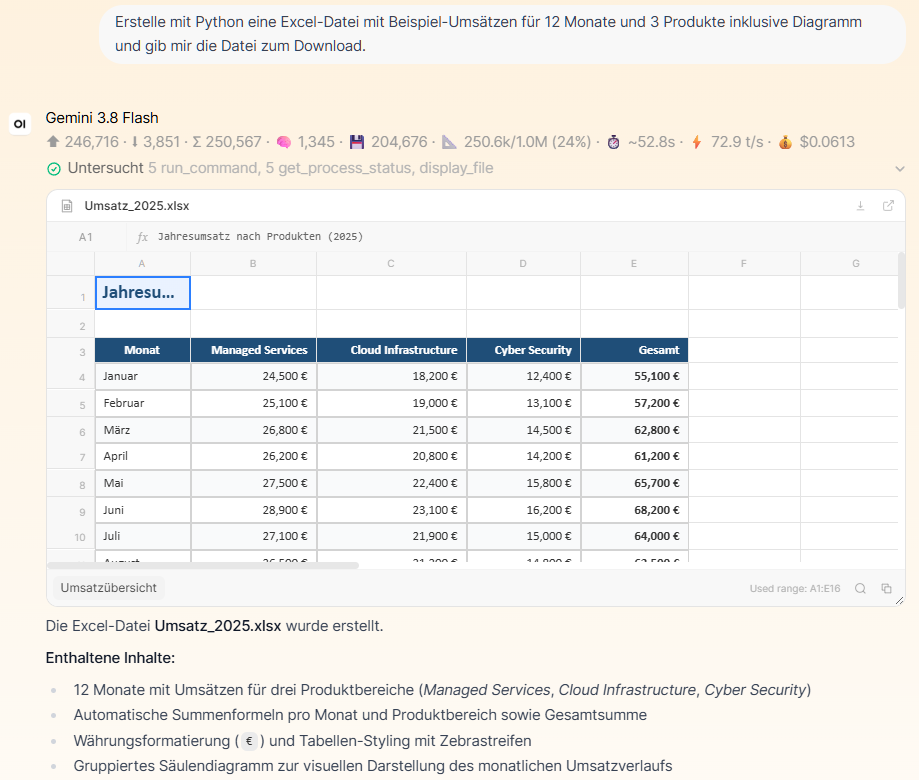

# AI platform (Open WebUI): user guide

This guide explains the main features of the AI platform that HXS runs for your company. It is based on [Open WebUI](https://openwebui.com) and works much like ChatGPT, with a few extra options.

Your company decides which models and features are enabled. Some parts of this guide may therefore be missing or named differently for you.

*Deutsche Fassung: [Anleitung](anleitung.md).* The screenshots show the German interface; the buttons are in the same places in English.

## Contents

1. [Signing in and getting started](#1-signing-in-and-getting-started)
2. [Choosing the right model](#2-choosing-the-right-model)
3. [Searching the web](#3-searching-the-web)
4. [Working with files](#4-working-with-files)
5. [Knowledge bases](#5-knowledge-bases)
6. [Your own assistants and prompt templates](#6-your-own-assistants-and-prompt-templates)
7. [Creating and editing images](#7-creating-and-editing-images)
8. [PowerPoint presentations](#8-powerpoint-presentations)
9. [Word documents and e-mails](#9-word-documents-and-e-mails)
10. [Diagrams and analyses](#10-diagrams-and-analyses)
11. [Programming and creating files: Files & Tools](#11-programming-and-creating-files-files--tools)
12. [Voice: dictation and read-aloud](#12-voice-dictation-and-read-aloud)
13. [More features](#13-more-features)
14. [Writing good prompts](#14-writing-good-prompts)
15. [Data protection and confidentiality](#15-data-protection-and-confidentiality)
16. [Frequently asked questions](#16-frequently-asked-questions)

---

## 1. Signing in and getting started

- Open the address you received from your IT department.
- Sign in with your **Microsoft work account** (the same one you use for Outlook or Teams). There is no separate password for the platform.
- Type your question or task at the bottom of the window and send it with **Enter**. **Shift + Enter** starts a new line.
- Your previous chats are listed on the left. Each chat gets a title automatically.
- To change the interface language: click your name at the bottom left → **Settings → General → Language**.

### Extra functions at the input field

The **+** on the left of the input field gives you everything else for the current chat:

- **Upload Files** and **Capture** (photo with the camera)
- **Add Context**: add knowledge, notes or earlier chats
- **Tools**: the model's extra tools (e.g. PowerPoint, e-mail); they are already selected
- **Web Search** and **Image** (image generation): switches for this chat

### Files & Tools (important for files)

**Files & Tools** is your personal folder on the server where the AI works: it can create and edit files there (Excel, Word, CSV …), run programs and give you the result to download. Nobody else can see your files.

**Files & Tools** is usually already switched on for the models. The **cloud icon** at the input field shows whether it is active. If it does not say *Files & Tools*, click the cloud icon and select it; you can also switch it off there for a chat.

### Difference from ChatGPT

You can choose between models from different providers (e.g. OpenAI, Google, Anthropic). Your chats, files and settings are stored by the platform that HXS runs for your company. To answer, however, your request is sent to the provider of the model you chose (more on this in section 15).

## 2. Choosing the right model

You choose the model **on the right of the input field** (it shows the name of the current model). One model is preset, and the most important ones are also pinned in the sidebar on the left. The exact choice changes all the time as providers release new models. As a rule of thumb:

| Kind of model | Recognisable by | Good for |
|---|---|---|
| **Fast and low-cost** | names like *Flash*, *Mini*, *Haiku*, *Nano* | everyday questions, short texts, summaries, translations |
| **Strong / all-round** | names like *Pro*, *Sonnet*, a provider's main models | longer texts, analyses, demanding wording, code |
| **Most capable** | names like *Opus* or a provider's largest models | difficult tasks, long documents, multi-step reasoning. Slower and more expensive |

The short description of each model (info icon) helps you choose. Start with the preset model and only switch if the result does not fit. You can also switch models in the middle of a chat.

### What a request costs

Providers charge by **tokens**. A token is part of a word; a page of text is roughly 500 to 800 tokens. You pay for everything sent to the model (your question, the chat so far, attached files, search results from the web) and for everything that comes back (the answer and, for "thinking" models, the thinking as well). Answers cost much more per token than input.

Prices vary widely between models. Examples (providers' list prices in US dollars per **1 million tokens**, as of November 2026, without guarantee):

| Model | Input | Answer |
|---|---|---|
| Claude Haiku 5.5 | $0.10 | $0.50 |
| Gemini 3.8 Flash | $0.75 | $3.75 |
| GPT-6.1 Terra | $1.00 | $5.00 |
| Claude Sonnet 5.5 | $2.00 | $10.00 |
| GPT-6.1 Sol | $2.00 | $10.00 |
| Gemini 3.1 Pro | $2.00 | $12.00 |
| Claude Opus 5.5 | $4.00 | $20.00 |

So an answer from Claude Opus costs about 40 times as much as the same answer from Claude Haiku. Current prices: [Anthropic](https://www.anthropic.com/pricing), [OpenAI](https://openai.com/api/pricing/), [Google](https://ai.google.dev/gemini-api/docs/pricing).

How to keep costs down:

- Use the fast models for everyday work and the large ones only for difficult tasks.
- Start a **new chat** for a new topic. In a long chat, the whole conversation so far is sent again with every question.
- Only attach the files the question needs.
- Switch off web search when you do not need current information.

## 3. Searching the web

Web search is already switched on for most models. The model searches by itself when a question needs current information and gives the sources as links.

- To switch it on or off: the **Web Search** switch at the input field (see section 1).
- Tip: write "Research on the web …" explicitly if you want to be sure it searches for current information.

> Example: *Research on the web the most important changes to the commuter allowance in 2026 and name the sources.*

## 4. Working with files

Drag a file into the chat window or attach it with the **plus icon**. PDF, Word, Excel, PowerPoint, text and images all work, for example.

- The model reads the file itself when needed, long documents completely, and names the **file name as the source** in its answer.
- You can attach several files at once (your company may limit their size and number).
- The model can "see" images and screenshots: e.g. an error message, a chart or a handwritten note.
- The model can also read scanned PDFs (paper pages with no text in them): the platform recognises the text automatically.
- If the AI is to change a file (e.g. add a column to your Excel file), it makes a copy in **Files & Tools** (section 1), edits it there and gives you the changed version to download.

> Example: *Summarise the attached contract in 10 points and highlight all deadlines.*

### Files from OneDrive and SharePoint

If your company has enabled it, you can bring files from OneDrive or SharePoint straight into the chat without downloading them first.

1. Click the **plus icon** in the chat and choose **Microsoft OneDrive (work/school)**.
2. A separate window (pop-up) opens with your OneDrive and the SharePoint sites. The first time, sign in with your work account if asked.
3. Select the file and confirm. It appears in the chat like an attached file.

Good to know:

- You only see files that you are allowed to open in OneDrive or SharePoint.
- The file is taken into the chat as a **copy**. If someone changes the file in SharePoint later, the chat does not see the change: select the file again for the new version.
- If no window opens, the browser is blocking the pop-up. In Edge an icon then appears on the right of the address bar: click it, choose **Always allow pop-ups and redirects** and open the selection again (see frequently asked questions).

## 5. Knowledge bases

A knowledge base is a collection of documents the model can use again and again, e.g. manuals, policies or product documentation.

1. **Workspace → Knowledge → New**: give it a name and upload files.
2. In the chat, type **#** and select the knowledge base. Or: attach the knowledge base permanently to one of your own assistants (see next section).
3. Sharing: you can share a knowledge base with colleagues or groups.

## 6. Your own assistants and prompt templates

**Your own assistants** (Workspace → Models → New): you choose a base model and add a fixed instruction ("You are our assistant for quotation texts, always answer in our company style …"), optionally a knowledge base. The assistant then appears in the model selection and can be shared.

**Prompt templates** (Workspace → Prompts): save instructions you use often as a template. In the chat, call them with **/** and the name.

> Example of a template `/minutes`: *Turn the following notes into meeting minutes with participants, decisions and open items (who, what, by when):*

## 7. Creating and editing images

1. Switch on **Image** with the **+** at the input field. Without the switch, some models only describe the image or draw a simple graphic as code.
2. Describe the image you want as precisely as possible: subject, style, colours, format.
- Editing: attach an image and describe what should change ("white background", "remove the logo").

> Example: *Create a friendly, modern cover image for a newsletter about spring cycling, flat illustration, colours green and white, landscape format.*

Note: providers restrict images of people, brands and logos. Check image rights before you use images externally.

## 8. PowerPoint presentations

The platform creates real PowerPoint files (.pptx) to download.

**New presentation:**

> *Create a PowerPoint presentation with 8 slides on "Introducing AI in customer service": title, starting point, 3 use cases, benefits in numbers, roadmap, next steps.*

**In your company design:** the platform creates presentations in its own neutral design. Apply your company template (slide master, fonts, colours) afterwards in PowerPoint:

1. Have the platform create the presentation and download it.
2. In PowerPoint, open a new presentation from your company template and take over the slides: **Home → New Slide → Reuse Slides**, with "Keep source formatting" switched off.

Tips: agree on content and outline in the chat first, then have the presentation created. Do the fine-tuning (images, exact positions) in PowerPoint afterwards.

## 9. Word documents and e-mails

**Word:** below every answer there is an **"Export to Word"** button. You get the answer as a formatted .docx file with headings, lists and tables.

- Your own Word templates (.dotx) are not used. For letters in your company layout, export the text and paste it into your template.

**E-mails:** if you ask for an e-mail, it appears as a card that you can edit, copy or download as an .eml file and open in Outlook.

> Example: *Write a friendly e-mail to a customer saying the delivery is delayed by one week, with an apology and the new date 14 November.*

## 10. Diagrams and analyses

**Flowcharts, org charts, timelines:** ask for a **Mermaid diagram**. It is drawn directly in the chat.

> Example: *Draw a Mermaid diagram of our holiday request process: request, check by the team lead, approval or query, entry in the calendar.*

**Charts from numbers (bar, line, pie):** paste data or attach an Excel file and ask for an analysis with a chart. With **Files & Tools** the model calculates in Python and gives you the chart as an image or in an Excel file to download.

> Example: *Analyse the attached Excel table: revenue per month as a line chart and the three strongest products as a bar chart.*

## 11. Programming and creating files: Files & Tools

**Files & Tools** is a Linux environment of your own on the server. There the AI creates and edits files (Excel, Word, CSV …), runs analyses, draws charts and also runs larger scripts.

- The model writes the code, runs it and explains the result.
- **Files & Tools must be switched on for files to download** (it usually is, see section 1). If it is switched off, the AI cannot create a file.
- The AI shows the finished file directly in the chat, with a preview and a download button. You also find all your files in the **Files** side panel.
- Your files stay in your folder; nobody else can see them.
- Choose the strong models for programming and calculation tasks (see section 2). Fast models tend to sidestep and only give you code to run yourself.

> Example (Files & Tools): *Use Python to create an Excel file with sample revenue for 12 months and 3 products, including a chart, and give me the file to download.*

## 12. Voice: dictation and read-aloud

- **Dictation:** microphone icon in the input field. What you say is turned into text.
- **Read aloud:** speaker icon below an answer.
- **Voice conversation:** with the call icon you talk to the model directly.

## 13. More features

- **Memory:** the AI can remember things about you (e.g. "I work in sales, keep answers short"). Manage it under **Settings → Personalization**, where you can view and delete entries.
- **Temporary chat:** is not saved. Switch it on in the model selection at the top.
- **Folders:** sort chats into folders (sidebar on the left).
- **Notes:** write your own notes and revise them with the AI.
- **Share a chat:** create a link from a chat's menu that signed-in colleagues can open.
- **Compare several models:** add a second model in the model selection. Both then answer the same question.
- **Rate answers:** thumbs up/down below an answer helps to improve the platform.

## 14. Writing good prompts

1. **State the goal:** what should come out at the end? ("an e-mail", "a table", "5 ideas")
2. **Give context:** for whom, what for, what background? Rather too much than too little.
3. **Set the form:** length, tone, structure ("max. 150 words", "informal", "as a table").
4. **Show examples:** one example of the style you want works better than any description.
5. **Refine:** the first answer is a draft. Say exactly what should be different.

AI can be wrong and make up facts. Check important statements, figures and quotes, especially before you pass them on.

## 15. Data protection and confidentiality

- HXS runs the platform for your company. Other users cannot see your chats unless you share them yourself.
- To answer, your input is sent to the provider of the model you chose (e.g. OpenAI, Google, Anthropic). According to their terms for business customers, the providers do not use this data to train their models.
- **Do not enter:** passwords, credentials, credit card and bank details, or special categories of personal data (e.g. health data), unless your company explicitly allows it.
- Personal data of customers or colleagues only as far as the task needs it. Often it is enough to replace names ("Customer A").
- Your company's internal policies on using AI apply. If in doubt, ask your IT department or your data protection officer.
- AI results are suggestions: you are responsible for how you use them.

## 16. Frequently asked questions

**I cannot see a model or feature from this guide.**
Your company enables models and features. Contact your IT department.

**The answer is cut off or stops.**
Write "continue", or regenerate the answer with the arrow icon. In very long chats, a new chat helps.

**The AI says it has created a file, but I cannot download it.**
Check at the cloud icon that **Files & Tools** is switched on, and have the file created again. If the file only appears as text or a link without a download: write "Show me the file".

**The model does not know about current events.**
Switch on web search or write "Research on the web …".

**Nothing happens when I click OneDrive.**
The browser has blocked the pop-up window. In Edge (and Chrome) an icon on the right of the address bar shows this: click it, always allow pop-ups for the platform's address and open the selection again.

**I cannot get in any more.**
Sign-in uses your Microsoft work account. Contact your IT department if sign-in does not work there or you have no access to the platform.
